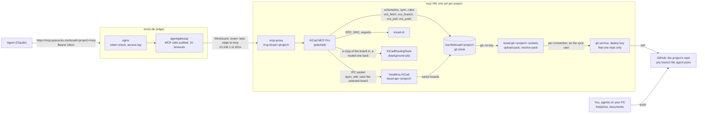

# MCP

`homelab.mcp.servers` runs MCP servers for agents, each as its own `mcp-<name>` unit and port. stdio servers
sit behind mcp-proxy: streamable HTTP on `http://<host>:<port>/mcp`, SSE on `/sse`. Nothing authenticates, so
the router decides who reaches which port (Altirix/Mikrotik), and only the edge's nginx (with tokens) puts the low-risk
ones on the internet (From outside). The VMs open every port they serve: a firewall on a VM is gone with root
on it, so none of what keeps them apart lives there. stdio servers share one process, and with it any state,
between clients. They run on labs, split by what a compromise of one gives away (Where servers run).

## Where servers run

A VM is the boundary: servers on one share its egress, its root and whatever its other servers hold.

| VM | Address | Servers | Why there |
|----|---------|---------|-----------|
| `hosts/virtual/mcp` | `10.100.1.11` | nixos, context7, time, memory, fdfdb, paperless, KiCad projects | hold tokens or data (paperless' token, memory's graph, the projects), only talk to known APIs |
| `hosts/virtual/mcp-web` | `10.100.1.13` | fetch, markitdown, playwright | read any page an agent names, playwright runs its code: nothing there to steal |
| `hosts/virtual/rea` | `10.100.1.12` | rea | runs the binaries it analyses, no egress, reset from a snapshot (rea) |

A new server goes on `mcp-web` if it reads arbitrary URLs or runs untrusted content, on `mcp` otherwise, on a VM of
its own if it runs what it's given. Both pass through the router's `labs: nothing private`. No server opens another on its own VM either
(`config/egress.nft`): past the edge's token check, a KiCad project's server would get another's.

Presets in `servers/` only need enabling in the host, anything else is added directly:

```nix
homelab.mcp.servers.sequential-thinking = {
  enable = true;
  command = lib.getExe pkgs.mcp-server-sequential-thinking;
  port = 8100;
};
```

Add it to a client:

```sh
claude mcp add --transport http sequential-thinking http://<host>:8100/mcp
```

`nix build .#checks.x86_64-linux.mcp` boots the servers `hosts/virtual/mcp` and `mcp-web` enable in a VM and calls each from
a client over the network, see `tests/mcp.nix`.

## Router (MikroTik)

Everything that keeps the MCP VMs apart is on the router, so it holds with root lost on either VM. The
hypervisors pin each VM to its address (`security.ipv4_filtering`, networking/README.md), so the router's
`src-address` matches can't be spoofed from labs. Never give `mcp`, `mcp-web` or `rea` the `labs-mesh` profile:
VXLAN goes VM to VM past the router.

Who gets in, and what they open, is on the router (Altirix/Mikrotik): `labs: edge to mcp` (the public
servers' ports, `public = true`, From outside), `labs: edge to mcp-web`, `labs: edge to rea`, `labs: tunnel to agents, nothing else`
(no other tunnel peer reaches either VM), `labs: rea opens nothing` (not the router, labs, home or out the
tunnel) and `labs: nothing private` (mcp and mcp-web reach the internet, for context7, nixos, fetch and playwright,
but never home, mgmt, labs or the edge's tunnel address). ssh from home still reaches them for deploys (`labs: home ssh, rdp`).

Agents on the LAN that should reach the servers directly (every port, playwright included),
one per machine, just above `labs: only home and tunnel in`:

```routeros
/ip firewall filter
add chain=forward action=accept connection-state=new src-address=<agent> dst-address=10.100.1.11 protocol=tcp dst-port=8100-8199,9200-9299 comment="labs: agents to mcp" place-before=[find comment="labs: only home and tunnel in"]
add chain=forward action=accept connection-state=new src-address=<agent> dst-address=10.100.1.13 protocol=tcp dst-port=8100-8199 comment="labs: agents to mcp-web" place-before=[find comment="labs: only home and tunnel in"]
add chain=forward action=accept connection-state=new src-address=<agent> dst-address=10.100.1.12 protocol=tcp dst-port=8101 comment="labs: agents to rea" place-before=[find comment="labs: only home and tunnel in"]
```

The `mcp` VM uses `1.1.1.1` for DNS, so it needs nothing from the router itself but time. Every labs NIC drops
IPv6 today (`ipv6_filtering`, no pinned v6 address); if labs ever carries IPv6, the same holds for v6 or a VM with
root egresses over it:

```routeros
/ipv6 firewall filter
add chain=forward action=drop connection-state=new src-address=<rea v6> comment="labs: rea opens nothing (v6)" place-before=0
add chain=input action=drop connection-state=new src-address=<rea v6> comment="labs: rea opens nothing (v6)" place-before=0
```

Check with `/ip firewall filter print stats where comment~"mcp|rea"`: the edge's 502s with
`labs: edge only to its sites` counting mean a port missing from `labs: edge to mcp`. If the router
ever masquerades into labs, the edge arrives as `10.100.0.1` instead of `10.0.0.1` and every edge rule misses.

## From outside

The servers marked `public` (nixos, context7, time, memory, fdfdb, paperless, the KiCad projects on `mcp`; fetch and
markitdown on `mcp-web`) are published (`homelab.publish`), and the edge's `mcp` site
(`hosts/edge/ionos-de/services.nix`, `from = [ "mcp" "mcp-web" "rea" ]`)
serves them at `https://mcp.peacocks.me/<server>/mcp`, proxied over the tunnel (streamable
HTTP only, SSE is deprecated). playwright runs code, it gets no route. Every
request needs `Authorization: Bearer <token>`, one token per client in `hosts/edge/ionos-de/secrets.yaml` so each
can be revoked, and the access log (the journal's `nginx_access`, on to the logs VM) names the client. OAuth
sign-in through Kanidm (`modules/services/sso`) is ready to replace the tokens later (`oauth` in place of `tokens` on
the site, its `mcp` and `mcp-cli` clients already exist), MCP doesn't use it yet. The router only lets the edge's tunnel
address `10.0.0.1` in on the exposed servers' ports (`labs: edge to mcp`), so a compromised edge still
doesn't reach the others. Never add a wireguard forward to `10.100.1.11`, `.12` or `.13`: forwards arrive from
`10.0.0.1` too and would skip the token. Exposing another server takes both, `public = true` on it and its
port in its VM's `labs: edge to` rule.

REA is also routed, `https://mcp.peacocks.me/rea/` → its own VM's nginx `10.100.1.12:8101`, on the same
token. It runs code a caller hands it but reaches nothing (no secrets, the router drops what it opens,
snapshot reset), so a leaked token lands in a dead-end sandbox. That rests on `labs: rea opens nothing`
being live, and covering IPv6 too if labs carries it.

Set it up: point an A record for `mcp.peacocks.me` at the VPS (ACME needs it before the first deploy), add a
token per client named in the site's `tokens` (`openssl rand -hex 32`), add the router rules (Altirix/Mikrotik), deploy `mcp`, then
`ionos-de`. ionos-de doesn't build with the tokens missing.

```sh
sops hosts/edge/ionos-de/secrets.yaml   # mcp-token-cloud: <hex>
```

Revoke one by removing it from the site's `tokens` and from `hosts/edge/ionos-de/secrets.yaml`, rotate one by
editing the secret alone (nginx reloads on deploy). Check from anywhere:

```sh
curl -i https://mcp.peacocks.me/time/mcp -H "Authorization: Bearer $MCP_TOKEN" \
  -H 'Content-Type: application/json' -H 'Accept: application/json, text/event-stream' \
  -d '{"jsonrpc":"2.0","id":1,"method":"initialize","params":{"protocolVersion":"2025-06-18","capabilities":{},"clientInfo":{"name":"curl","version":"0"}}}'
```

Claude Code on a laptop, per server:

```sh
claude mcp add --transport http time https://mcp.peacocks.me/time/mcp --header "Authorization: Bearer $MCP_TOKEN"
```

Or in a repo's `.mcp.json`, reading the token from the environment when Claude Code starts. This repo's own
`.mcp.json` leaves out the `headers`, for cloud sessions (below):

```json
{
  "mcpServers": {
    "nixos": {
      "type": "http",
      "url": "https://mcp.peacocks.me/nixos/mcp",
      "headers": { "Authorization": "Bearer ${MCP_TOKEN}" }
    },
    "time": {
      "type": "http",
      "url": "https://mcp.peacocks.me/time/mcp",
      "headers": { "Authorization": "Bearer ${MCP_TOKEN}" }
    }
  }
}
```

Claude Code cloud sessions read the same `.mcp.json` from the repo they run in. In the cloud environment's
settings, allow `mcp.peacocks.me` under Network access (Allowed domains, or Full), and add the `cloud` token
as a network secret for `mcp.peacocks.me` so the agent proxy adds `Authorization: Bearer <token>` outside the VM
and the token never reaches the session. Leave out the `headers` then. That the proxy injects it for MCP traffic
isn't documented, so check after deploy that requests show up as `cloud` in ionos-de's access log
(`journalctl -t nginx_access`). If they arrive as 401, set `MCP_TOKEN` as an environment variable of the environment instead and keep
the `headers` (the session can then read the token).

## Usage

Four views, all in VictoriaLogs (`modules/services/logs`):

- **Every client, per request**: the edge's access log (`SYSLOG_IDENTIFIER:nginx_access`) has the client, path,
  status and duration of each request through `mcp.peacocks.me`.
- **Every client, per tool call**: `mcp.peacocks.me` is audited (`audit = true` in
  `hosts/edge/ionos-de/services.nix`): its MCP endpoints go through agentgateway on the edge, which understands
  MCP. Each call goes to the logs VM over OTLP with the tool (`mcp.tool.name`, `mcp.tool.target` the server), its
  arguments and result (`mcp.arguments`, `mcp.result`, `mcp.error`) and the client (`web.user`, from the token);
  a shorter line without arguments and results goes to the edge's journal (`_SYSTEMD_UNIT:agentgateway.service`).
  Arguments and results can hold whatever the tools were given or fetched, the logs VM keeps them for its
  retention. REA's uploads and shared files aren't MCP and pass straight through.

  ```
  mcp.tool.name:* | fields _time, web.user, mcp.tool.target, mcp.tool.name, mcp.arguments, mcp.result
  mcp.tool.name:* | stats by (web.user, mcp.tool.target, mcp.tool.name) count()
  mcp.error:* | fields _time, mcp.tool.target, mcp.tool.name, mcp.error
  ```

- **Where servers reach out to**: the `mcp` VM logs each server's first TCP or UDP connection to every address and
  port, then none to that one for an hour (each runs as its own `mcp-<name>` user), kernel lines like
  `mcp-egress fetch: ... DST=1.2.3.4 ... DPT=443`. Addresses only, the name it looked up isn't there.

  ```
  _HOSTNAME:mcp "mcp-egress" | extract "mcp-egress <server>: " | extract "DST=<dst> " | extract "DPT=<port> " | stats by (server, dst, port) count()
  ```

- **Claude Code, per tool call**: Claude Code's own OpenTelemetry export has a `claude_code.tool_result` event for
  every tool it calls, MCP or not, with the tool, its MCP server, success, error and duration, and with
  `OTEL_LOG_TOOL_DETAILS=1` its parameters (which can hold secrets). VictoriaLogs takes OTLP directly. In
  `~/.claude/settings.json` on each machine that should report (one that reaches the logs VM, `labs: logs in`), not
  this repo's `.claude/settings.json`, which cloud sessions also read and couldn't send from:

  ```json
  {
    "env": {
      "CLAUDE_CODE_ENABLE_TELEMETRY": "1",
      "OTEL_LOGS_EXPORTER": "otlp",
      "OTEL_EXPORTER_OTLP_PROTOCOL": "http/protobuf",
      "OTEL_EXPORTER_OTLP_LOGS_ENDPOINT": "http://10.100.0.11:9428/insert/opentelemetry/v1/logs",
      "OTEL_LOG_TOOL_DETAILS": "1"
    }
  }
  ```

  ```
  claude_code.tool_result mcp_server_name:* | stats by (mcp_server_name, mcp_tool_name, success) count()
  claude_code.tool_result success:false | fields _time, mcp_tool_name, error, tool_parameters
  ```

Claude's connectors (claude.ai, the apps) only show up in the access log and agentgateway's, they export nothing.

## rea (8101)

Decompiles with Ghidra, reads APKs with JADX, runs samples and unpacks firmware. It only runs on
`hosts/virtual/rea` (`10.100.1.12`): each project in `homelab.mcp.rea.projects` has a supergateway of its
own (`rea@<project>.service`, `config/rea-gateway.json`), which starts a REA for each MCP session, so agents never
close or replace each other's target; a session idle for 30 minutes ends, and its REA with it. nginx on 8101
(`homelab.mcp.rea.port`, `config/rea-nginx.conf`, reached through the router's `labs: edge to rea`) is
the only way in, the gateways (each project's port in `homelab.mcp.rea.projects`, 9100 up) only listen on loopback:

```
https://mcp.peacocks.me/rea/<project>/mcp       the project's server
https://mcp.peacocks.me/rea/<project>/samples/  its uploads, /var/lib/rea/<project>/samples on the VM
https://mcp.peacocks.me/rea/<project>/shared/   what its sessions share, read-only, /var/lib/rea/<project>/shared
```

A repo's `.mcp.json` points at its project:

```json
{ "mcpServers": { "rea": { "type": "http", "url": "https://mcp.peacocks.me/rea/<project>/mcp" } } }
```

Adding a project is a line in `hosts/virtual/rea` and a deploy, the edge needs nothing. Each session takes
about 1.5 times Ghidra's heap (`homelab.mcp.rea.ghidraHeap`, 1G here) once it has a target open, and all of them
together, every project's, at most `homelab.mcp.rea.memoryMax` (75% of the VM, `rea.slice`): past that the kernel ends a session, not the VM.
There's no cap on sessions, so size the VM's `limits.memory` for what runs at once.

REA's tools take paths on the VM, so samples are uploaded first and opened by that path:

```sh
curl -T sample.apk https://mcp.peacocks.me/rea/<project>/samples/sample.apk
curl https://mcp.peacocks.me/rea/<project>/samples/                           # list
curl -X DELETE https://mcp.peacocks.me/rea/<project>/samples/sample.apk
```

From a cloud session the agent proxy adds the token. Uploads are up to 1G, one level (no subdirectories), land
`0644`, and the server only reads them.

### Projects and sharing

Projects are isolated from each other: each runs as its own user (`rea-<project>`) and sees only its own
directory, so a sample one project runs can't read or change another's files, nor reach its processes. That's
against samples, not agents: every client's token opens every project's URLs, so keep apart there by client, not
by project. The VM is still a disposable sandbox, what matters lives in the projects' repos.
Each project's sessions pass work along through its shared directory:

```
/var/lib/rea/<project>/
  samples/<name>                         uploads, read-only to REA
  shared/evidence/<branch>__<agent>.json export_evidence_bundle, import_evidence_bundle
  scratch/<agent>/<new dir>              extract_firmware output_directory, executable copies (REA's cwd)
  home/                                  REA's HOME
```

Agents on the same branch import each other's evidence, a different branch starts its own. REA only writes into
existing directories, so the names stay flat (`/` in a branch becomes `-`), and writes them `0600`, so
`rea-shared@<project>.path` makes them group-readable for nginx a moment after they land.

Bundles carry findings as evidence records, not a Ghidra database: importing one doesn't rename anything in the
importing session's binary, and REA's snapshots are the same records (no Ghidra analysis in them), so every
session pays Ghidra's analysis (~90 s for a 1 MB firmware) on its first query. Names and comments that should
outlive a session go in the project's repo (address, name, why) and are re-applied with `set_addresses_names` and
`annotate_native_function`; `set_comment` is Hopper only. Nothing in a session survives it ending (DELETE, 30 idle minutes, a reset) except what it exported, so agents
export after every finding worth keeping. To keep a bundle beyond the VM (in the project's repo, say), download
it, and upload it as a sample to import it again:

```sh
curl -fsS https://mcp.peacocks.me/rea/<project>/shared/evidence/                  # list
curl -fsSO https://mcp.peacocks.me/rea/<project>/shared/evidence/main__agent-1.json
curl -fsS -T main__agent-1.json https://mcp.peacocks.me/rea/<project>/samples/main__agent-1.json
```

### Dynamic analysis

`homelab.mcp.rea.dynamic = true` builds REA in full: `capture_process_scenario` runs the command it's given
under a PTY, `capture_browser_scenario` drives Chromium (`executable_path` `/etc/rea/chromium`, Playwright's own
build). Both work under the unit's sandbox as it is, nothing is relaxed. Samples run as `rea` and see what it
sees: the store, world-readable `/etc` and `/var/lib/rea`. Uploads aren't executable, copy one into scratch first
(`capture_process_scenario` with `install -m755 /var/lib/rea/<project>/samples/<name>
/var/lib/rea/<project>/scratch/<agent>/<name>`). rizin (`execute_rizin_command`, ESIL
emulation, debug sessions) and objdump are there; gdb, Frida and adb aren't on PATH, so their tools still fail, and binaries built for other distributions need their own
loader (no nix-ld), Electron apps included. `homelab.mcp.rea.firmware = true` adds binwalk and unblob (26.6, the
release REA takes) so `inspect_firmware_regions` and `extract_firmware` work; they parse untrusted blobs with
their own extractors, which is why they stay on this VM.

The VM serves nothing else (asserted), holds no secrets (it isn't a sops recipient) and is contained:

- **Who connects**: the router, `labs: edge to rea` (and `labs: agents to rea` per LAN agent).

- **Egress**: the router's `labs: rea opens nothing` drops every connection the VM opens but its journal's to the
  logs VM's insert port (`labs: rea ships logs`), so samples can't phone home or scan labs, and browser scenarios only load `http://127.0.0.1` pages. Nothing on the VM
  enforces it, so root there changes nothing. It has no DNS or NTP either, and deploys push the closure (no
  `--use-substitutes`).

- **Data**: `/var/lib/rea` is the `rea-data` volume, which the instance snapshot doesn't include. REA and nginx
  won't start without it. Create it once:

  ```sh
  incus storage volume create ceph rea-data --type=block size=100GiB
  incus config device add rea data disk pool=ceph source=rea-data
  ssh admin@rea.labs.internal lsblk                           # the new, empty disk, e.g. sdb
  ssh admin@rea.labs.internal 'sudo mkfs.ext4 -L rea-data /dev/sdb'
  ```

- **Reset**: snapshot the VM stopped once installed (and again after each deploy), roll its root back when no
  session is running. It restarts every session, the volume (and whatever samples wrote to it) stays:

  ```sh
  incus stop rea && incus snapshot create rea clean --reuse && incus start rea
  incus snapshot restore rea clean
  ```

## KiCad (9200-9299)

`homelab.mcp.kicad` (`servers/kicad.nix`) gives each project in `projects` a git repo in `/var/lib/kicad/<project>`
and its own KiCad MCP Pro server, at `https://mcp.peacocks.me/kicad/<project>/mcp`, confined to that repo. Agents on
different projects never share a server or files; agents on the same one share both, so give each line of work its
own project. ERC/DRC, BOM and exports run through `kicad-cli`. A commit takes everything under the project but what
`config/kicad-gitignore` leaves out (KiCad's lock files, view settings, caches and backups, the server's reports). In `write` mode (the default) the `builder` tool set
creates projects, edits schematics and boards and commits (`vcs_commit_checkpoint`); `readonly` keeps agents to
inspecting, checking and exporting. Its outputs still need your review before fabrication.

Boards are edited live through KiCad itself, headless: each project has a `kicad-api-<project>` service running
`kicad-cli api-server`, KiCad's API without a GUI, sandboxed to the project's repo like its server. An agent picks
the board with `kicad_set_project` (`pcb_file`), works on it (placing, routing, zones, `pcb_save`), commits, then
selects the next board in the same project: the one before is saved and closed. A board whose file changed on disk
since KiCad opened it (the sync brought in a commit) is never saved over: it's opened again, or closed unsaved when
the agent moves on, and its unsaved live edits go with it (so do they after the server restarts). Selecting a board
that doesn't exist is an error, boards are generated or created first. A project has one selected board, shared by
every agent on it: two agents editing different boards at once take it from each other.

Routing (`mode = "experimental"` on `mcp`, KiCad MCP Pro keeps it behind that) is KiCadRoutingTools
(`packages/kicad-routing-tools.nix`, built from source, its Rust router too), in place of FreeRouting, which on a board
that already had copper never finished a pass. Its scripts work on files: `route_krt_start` saves the open board,
copies it with its `.kicad_pro` and `.kicad_dru` into `.kicad-mcp/krt/` and runs one there in the background
(`autoroute.py` for the whole chain, or step by step: `route_planes.py`, the fan-outs, `route_diff.py`, `route.py`
with its length and time matching), returning straight away, or with the output when it ends within
`wait_seconds` (`--help`, the checks). `route_krt_status` reports its steps so far, then the result; agents check
it every 5-10 minutes. `route_krt_apply` makes a board it wrote the project's board, which KiCad reloads: live edits
made since the copy are lost, so agents leave the board alone meanwhile. `route_krt_docs` has its documentation and
routing skills (`skills/plan-pcb-routing`). It routes to the fab limits in the project's rules: autoroute.py reads
the `.kicad_pro` and `.kicad_dru`, and where they disagree it goes by the `.kicad_dru` and says so (on the PalmRemote
core board, 0.1 mm tracks and 0.45 mm vias, which KiCad's DRC then flags against the project's 0.2 and 0.5), so keep
the two the same; the other scripts take the limits as options (`packages/kicad-mcp-pro-krt.patch`). `route_differential_pair`, `route_tune_length` and
`tune_diff_pair_length` don't draw: they write the width, gap, skew and length targets into the project's design
rules (`<project>.kicad_dru`, committed with it) and report the lengths as they are, DRC checks them. Every edit
goes straight to the file, there's no undo on the server: commit before anything big, `git revert` is the undo.

Agents also get the project as they would on a PC (`packages/kicad-mcp-pro-workspace.patch`), so they aren't
limited to what the tools above return: `file_list`, `file_read`, `file_search` (git grep), `file_write` and
`file_edit` anywhere in its repo but its `.git` (binary files as base64, up to 8 MB; images read back as
images); `shell_run`, a bash in the repo as its server, with kicad-cli, git
(pushes still go through the gate), Python with numpy, scipy, shapely and Pillow, and KiCadRoutingTools in `$KRT`
(what runs past `wait_seconds` goes on as a job: `shell_status`, `shell_cancel`); `kicad_ipc`, any request of
KiCad's own API as JSON on the open board (no command lists them); and the board as images: `pcb_render_png` (any layers, inner ones too, or
sets: `top`, `bottom`, `copper`, `inner`, one image per layer with `each_layer`, zones filled for the image),
`pcb_render_visual_diff` (two versions, removed in red, added in green) and `pcb_render_3d` (with the parts' 3D
models, about 460 MB in the store), each also as it was at a step or a KRT result. ngspice is there for the `sim_*`
tools and the shell. Each project's server, with all it runs, is held to `memoryMax` (3G), its jobs niced and the
first the kernel stops, so a runaway one never takes the headless KiCad down with it. After every call that may have changed something the server makes a step: the
open board is saved and the repo's files, as git would commit them, go into a commit on `refs/kicad-mcp/steps`
through an index of its own, so the project's index and branches are untouched and steps are never pushed.
`vcs_list_steps`, `vcs_diff_steps` and `vcs_restore_step` (itself a step) go through them. The shell is a shell on the
VM as that project's user: it reaches what the server does, its repo and the internet, not the deploy key or another
project, and `readonly` mode leaves only the reads.

That API server only exists in KiCad's development branch (what becomes KiCad 11), so every KiCad on the server is
that one (`packages/kicad-master.nix`, pinned, compiled by the build host, an hour or so), with KiCad MCP Pro patched
to open the selected board (`packages/kicad-mcp-pro-headless.patch`) and kicad-python built from git against it
(with `packages/kicad-python-create-items.patch`, its fix for creating items).
**It saves in its own file format (10.99), which KiCad 10 doesn't open**: use a KiCad nightly, or export copies KiCad
10 opens (`kicad-cli pcb downgrade -o board-k10.kicad_pcb board.kicad_pcb`, `kicad-cli sch downgrade`, with KiCad
master). Bump KiCad and kicad-python together, their API definitions have to match.

Each project is a clone of its source, a repo with something committed (GitHub's "Add a README" will do), on
`branch` (main) to start with. After that agents do git themselves, as they would on a PC: `vcs_fetch`,
`vcs_branch` (list, switch, create), `vcs_commit_checkpoint`, `vcs_pull` (merges a branch in, also mid-edit unless
it touches files with uncommitted edits; a conflict is undone and named) and `vcs_push` (never forced). Nothing
moves on its own: work reaches GitHub when an agent pushes, your footprints and documents come in when it pulls, so
tell agents to push when they're done. Files not in git are never touched. The server's git has no key: the
source's url goes through two sockets (`kicad-git-<project>-upload-pack`, `-receive-pack`) that only its server
reaches, and behind each, per connection, the project's sync user runs git's own service on that one repo with
the deploy key. Pushes go through a gate first, a bare repo of the sync user's that refuses pushes to the
protected branches (`protect`, main), force pushes and deletions, and pushes the rest on to GitHub within the same
push (GitHub's own branch protection needs a paid plan for private repos). So agents push branches of their own and
you merge them into main on GitHub. See the flow below. Add a project in
`hosts/virtual/mcp/default.nix` with a free port of its own (9200-9299), deploy `mcp` and `ionos-de` (the route) and
widen nothing: `labs: edge to mcp` covers 9200-9299.



```nix
homelab.mcp.kicad.projects.palmremote = { port = 9200; url = "git@github.com:you/palmremote.git"; };
```

An ssh source needs a deploy key with write access, one per repo (GitHub allows a key on one repo only): add the
public half to the repo (Settings, Deploy keys, Allow write access), the private half to the mcp VM's secrets. Until
it's there the clone retries every minute, and the project's server starts once it's through.

```sh
ssh-keygen -t ed25519 -N '' -C kicad-palmremote -f kicad-deploy-key-palmremote
sops hosts/virtual/mcp/secrets.yaml   # kicad-deploy-key-palmremote: | <the private key, indented>
```

The clone is made once. To point a project at another source, change its url and move its repo aside (it clones
again on the next start).

## fdfdb (8110)

NAND flash by part number or by the ID its READ ID returns, with the controllers that support it, from
[iTXTech/fdfdb](https://github.com/iTXTech/fdfdb) (CC BY-NC-SA 4.0): the flash tables of Silicon Motion, Phison,
Maxio, JMicron, Innostor, YEESTOR, ChipsBank, Alcor, FirstChip and SandForce tools. `packages/fdfdb-mcp.py` reads
them into one index at build time, so a table whose format changed fails the build. Part numbers keep each
table's spelling (package and mode suffixes), so searches match on substrings and IDs on shared prefixes. Bump
`rev` and `hash` in `packages/fdfdb.nix` for new tables.

## context7 (8104)

Serves its own `/mcp` (no `/sse`). An API key is optional, per client: `--header "Context7-API-Key: <key>"`.
